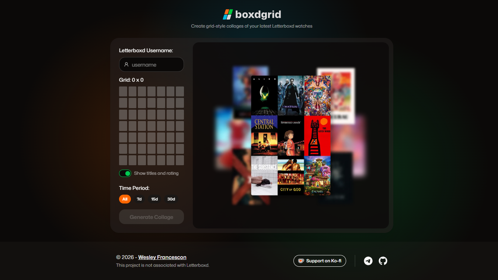

#  boxdgrid

Generate grid-style collages of your latest Letterboxd watches.

[](https://boxdgrid.com)

## Preview



## About

**boxdgrid** is a web app built with [Vinext](https://vinext.dev) (Cloudflare's Vite-based Next.js implementation) running on **Cloudflare Workers** that lets you generate grid-style collages using movie posters from your [Letterboxd](https://letterboxd.com) account.

You can choose different grid sizes and also filter films by a time period (for example, the last 30 days).

## Usage

1. Access: https://boxdgrid.com
2. Enter your Letterboxd username
3. Select a grid size (e.g. 3×3, 4×4, 5×5)
4. Optionally filter by a time range (e.g. last 30 days)
5. Generate and download your collage

## Running locally

### Requirements

- [Node.js](https://nodejs.org) (v20+)
- [pnpm](https://pnpm.io)

### Installation

```bash
git clone https://github.com/wfrancescons/boxdgrid.git
cd boxdgrid
pnpm install
```

### Run the project locally

```bash
pnpm dev
```

### Build and Deploy to Cloudflare Workers

```bash
# Build
pnpm build

# Deploy via Wrangler
pnpm deploy
```

## Tech Stack

- **Framework**: [Vinext](https://vinext.dev) (Next.js App Router on Vite)
- **Deployment & Runtime**: Cloudflare Workers & Wrangler
- **UI & Styling**: React 19, Tailwind CSS v4, daisyUI v5
- **Icons**: Lucide React

## Notes

- Uses public Letterboxd data (no authentication required)
- Collages are generated dynamically in the browser

## Support

If you find this project useful, consider supporting it:

<a href="https://ko-fi.com/wfrancescons" target="_blank">
  
</a>
